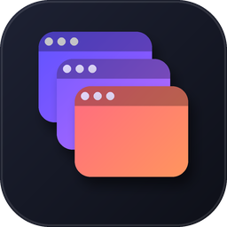
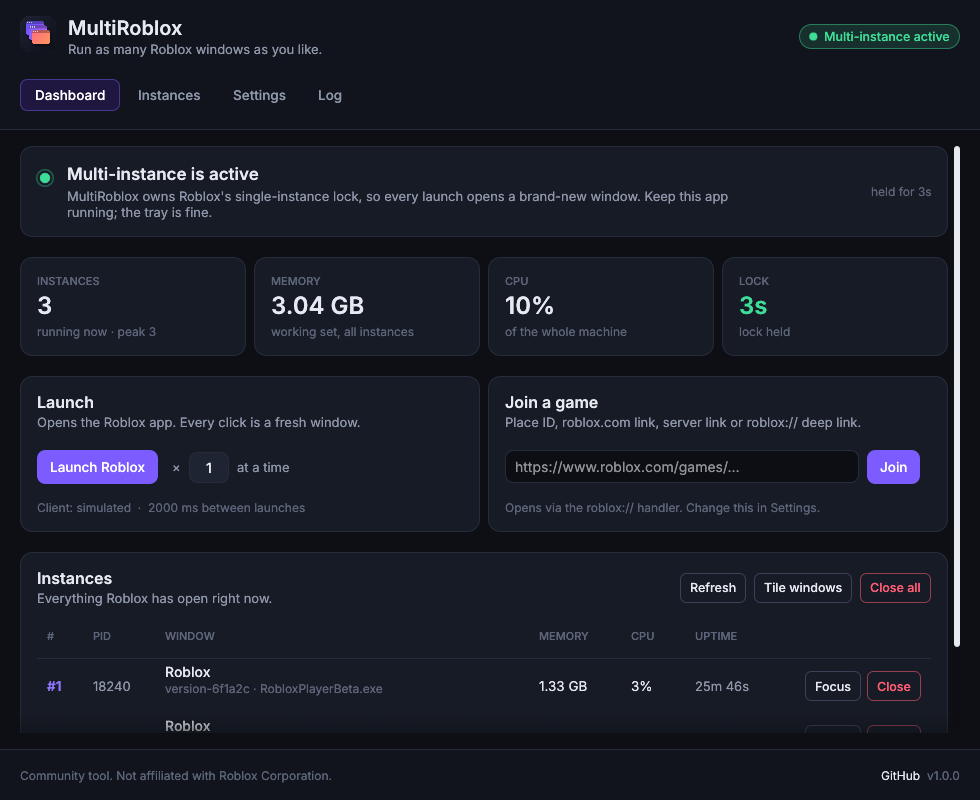
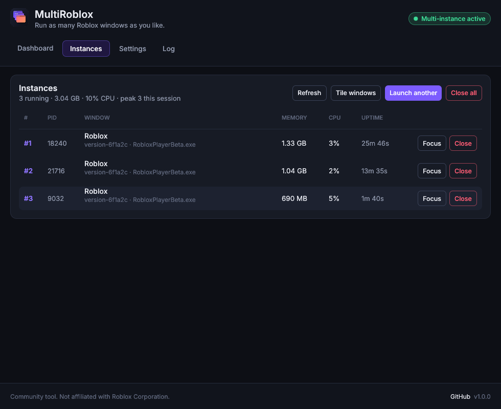
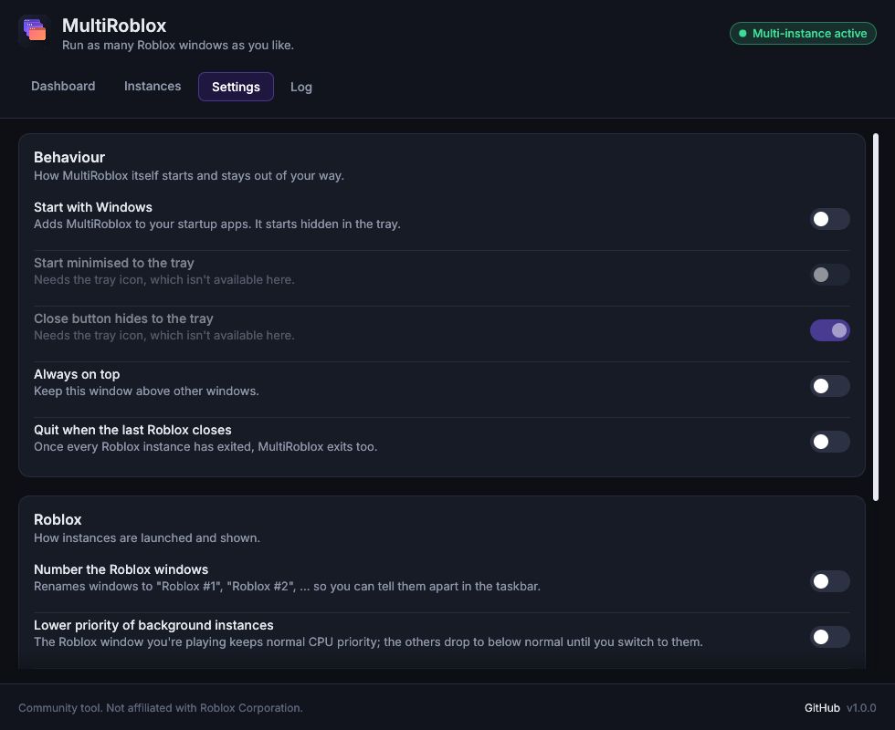

<p align="center">
  
</p>

<h1 align="center">MultiRoblox</h1>

<p align="center">
  Run as many Roblox windows as you like, from one small dashboard.<br>
  Native Windows app, single <code>.exe</code>, no installer, no runtime to install.
</p>

<p align="center">
  
</p>

## What it does

Roblox only lets one client run per Windows session: the first instance takes a
named kernel lock and every later launch just focuses that window. MultiRoblox
takes that lock first and keeps it for as long as it runs, so every launch opens
a brand-new window. That is the whole trick, and it is the same one every
multi-instance tool uses. Around it there is a proper dashboard:

- **Launch** the Roblox app with one click, or several instances at once with a
  configurable delay between them.
- **Join a game** straight from a place ID, a `roblox.com/games/...` link, a
  specific-server link, a private-server link or a raw `roblox://` deep link.
- **Instances table** with PID, window title, memory, CPU, uptime, and
  **Focus** / **Close** buttons per instance, plus a two-step **Close all**.
- **Tile windows**: one click arranges every Roblox window in a grid on your
  monitor.
- **Optional window numbering**: rename windows to `Roblox #1`, `Roblox #2`, …
  so you can tell them apart in the taskbar.
- **Lower priority of background instances** (optional): the window you're
  playing keeps normal CPU priority, the rest drop to below normal until you
  switch to them.
- **Tray icon** with a menu (open, launch, close all, quit). Closing the window
  hides to the tray so the lock stays held.
- **Start with Windows**, start minimised, always-on-top, and
  **quit automatically when the last Roblox closes**.
- **Bootstrapper friendly**: joins go through whatever handles `roblox://`
  links on your PC (Bloxstrap, Fishstrap, vanilla), and the launcher finds
  `RobloxPlayerBeta.exe` in the vanilla and bootstrapper install folders.
- **Takes over automatically**: if Roblox is already running when you start the
  tool, it waits and grabs the lock the moment the last Roblox window closes.
- **Activity log** with timestamps, copy and clear.
- Only one copy of the tool runs at a time; launching it again just brings the
  existing window to the front.

<p align="center">
  
  
</p>

## Download

- **Releases**: the `MultiRoblox.exe` attached to the
  [latest release](https://github.com/zewj/MultiRoblox/releases/latest) is
  built by GitHub Actions from the tagged source.
- **Every push**: the `build` workflow uploads `MultiRoblox-windows-x64` as an
  artifact on each run.
- **Quick start**: `dist/MultiRoblox.exe` in this repository is a
  cross-compiled build of the current source for people who want to try it
  without waiting for CI.

Windows SmartScreen will warn about an unsigned executable the first time; click
*More info* → *Run anyway*. Some antivirus heuristics dislike programs that
hold mutexes and enumerate processes; the full source is here if you would
rather build it yourself.

## Usage

1. Close any Roblox window that is already open (or let the tool close them
   from the status card).
2. Start `MultiRoblox.exe`. The badge in the header turns green:
   **Multi-instance active**.
3. Launch Roblox however you like: the **Launch Roblox** button, the **Join**
   box, the Roblox website, or your bootstrapper. Each launch is a new window.
4. Leave MultiRoblox running (hidden in the tray is fine). When it exits, the
   lock is released and Roblox goes back to single-instance behaviour.

Command line flags:

```
MultiRoblox.exe [--minimized] [--tab dashboard|instances|settings|log]
MultiRoblox.exe --doctor
```

`--doctor` runs a ten-second check without the GUI (lock, Roblox processes,
client location, `roblox://` handlers, autostart, settings) and opens the
report in Notepad. Paste that report into an issue if something doesn't work.

Settings live in `%APPDATA%\MultiRoblox\settings.json`.

## Building

Requirements: a stable Rust toolchain (1.95 or newer).

```bash
cargo build --release
```

The binary is `target/release/MultiRoblox.exe`. On Linux or macOS the same
command builds a **preview** of the UI with simulated Roblox instances, which
is how the screenshots above were made and how CI runs the lint and tests.

Cross-compiling from Linux:

```bash
sudo apt install gcc-mingw-w64-x86-64
rustup target add x86_64-pc-windows-gnu
cargo build --release --target x86_64-pc-windows-gnu
```

Checks that CI runs:

```bash
cargo fmt --all -- --check
cargo clippy --all-targets -- -D warnings
cargo test
```

## How it works, in a little more detail

- `src/platform/windows.rs` creates the `ROBLOX_singletonMutex` mutex (and the
  older `ROBLOX_singletonEvent`) with initial ownership. If the mutex already
  exists, somebody else owns it and the monitor retries once a second.
- The monitor thread lists `RobloxPlayerBeta.exe` (and the Microsoft Store
  build) with ToolHelp, reads memory and CPU time with limited-query process
  handles, and matches top-level windows to processes for titles and focus.
- Launching runs `RobloxPlayerBeta.exe --app` for a plain instance, or hands a
  `roblox://placeId=…` deep link to the registered protocol handler for joins.
- The UI is [egui](https://github.com/emilk/egui) with the
  [Inter](https://rsms.me/inter/) typeface (SIL OFL, see `assets/fonts`).
- Everything Windows-specific is isolated behind `src/platform/`, with a mock
  backend for other platforms.

## Notes

- MultiRoblox never touches your account, cookies or the Roblox client files.
  It only holds a lock, watches processes and starts the client.
- Using several accounts at once may still be against Roblox's rules for some
  activities; that part is on you.
- Not affiliated with, endorsed by or associated with Roblox Corporation.

## License

MIT, see [LICENSE](LICENSE).
